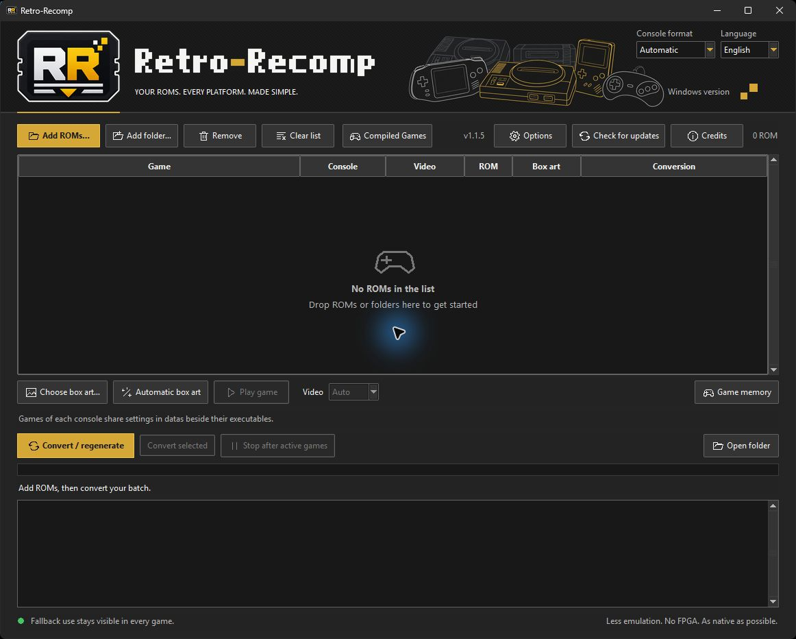
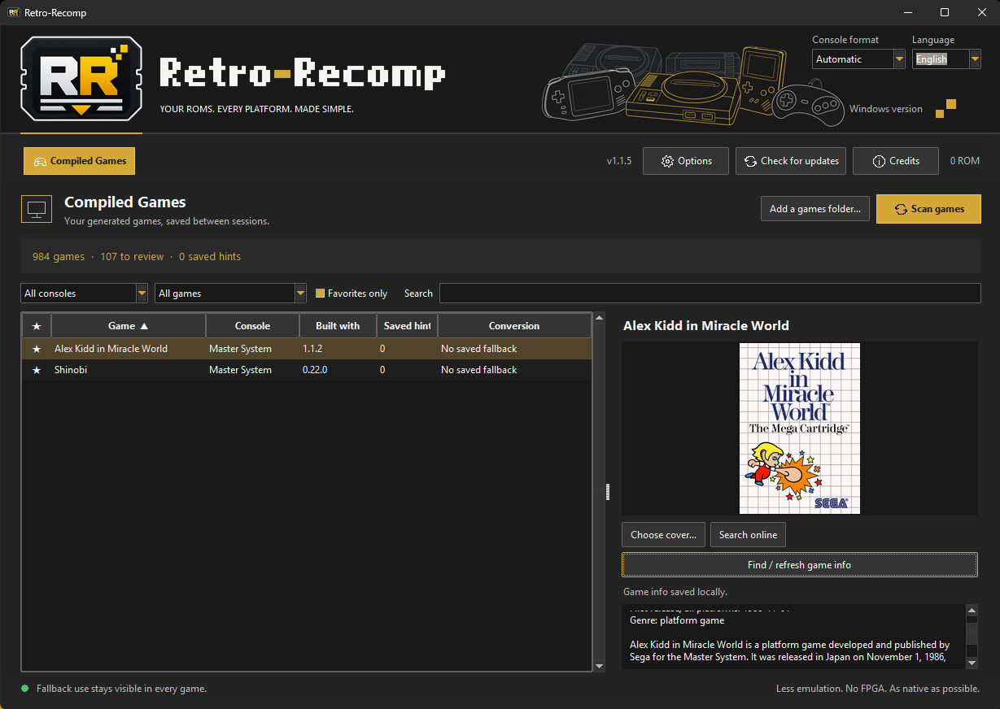
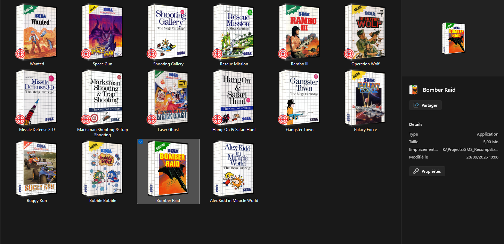
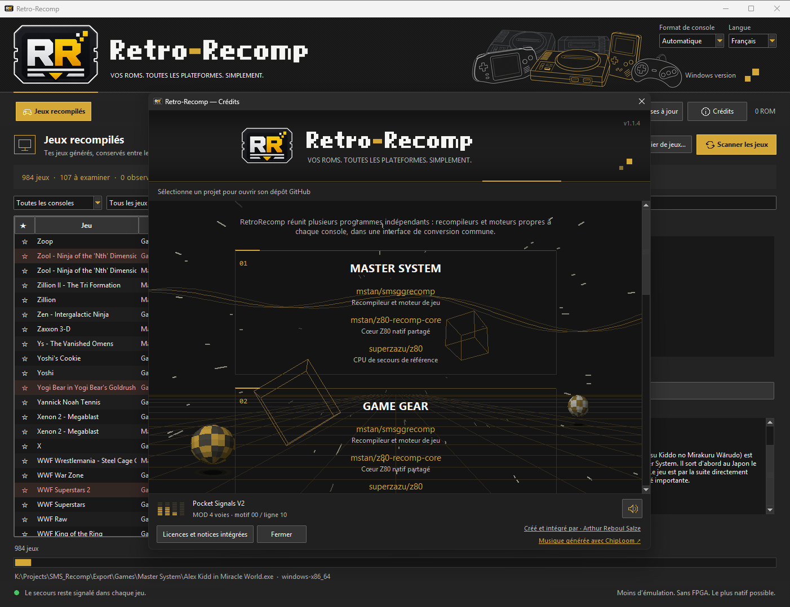
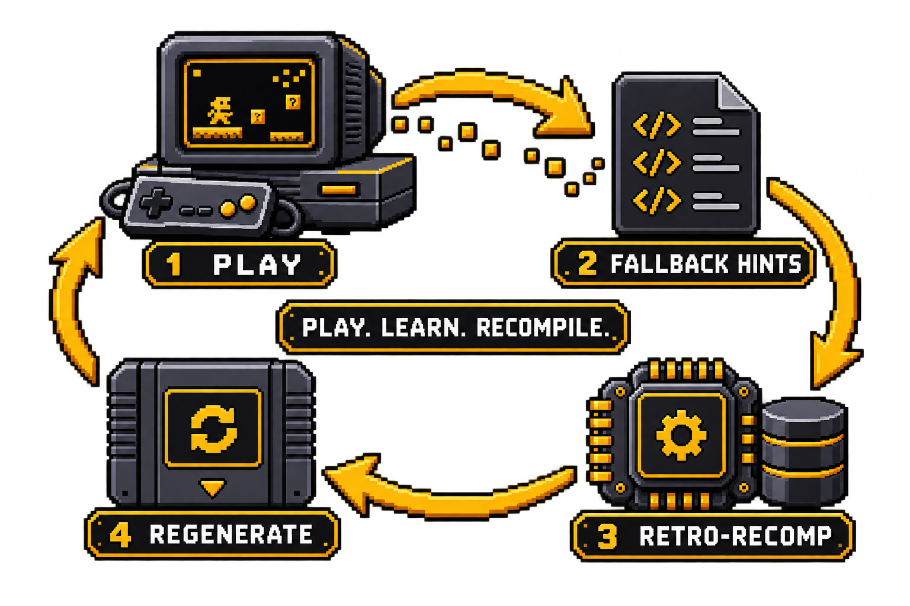

  

<h1 align="center">RetroRecomp</h1>

<strong>Multiple retro consoles. One app. Your games, ready to launch.</strong>

Master System · Game Gear · Game Boy · NES · Mega Drive · Super Nintendo · Neo Geo

<em>Less emulation. No FPGA. As native as possible.</em>

  
  
  
  

  <a href="https://github.com/ArthurReboulSalze/RetroRecomp/releases">Download</a> ·
  <a href="docs/BUILDING.md">Build from source</a> ·
  <a href="docs/COMPATIBILITY.md">Compatibility</a> ·
  <a href="THIRD_PARTY_NOTICES.md">Credits and licensing</a>

RetroRecomp brings several recompilers together in one application. It recompiles
game code into standalone Windows or Linux executables for a simple, responsive
retro gaming experience, with as much native execution as possible and no
dedicated FPGA hardware.

## From conversion to your game collection

*The Windows interface, with Compiled Games, selective conversion and manual updates. Linux shares the same layout.*

*Compiled Games keeps your collection, favorites, box art and saved game summaries together.*

*An example collection of generated Master System games, with optional box-art icons.*

*Animated credits combine a demoscene backdrop with live four-channel ChipLoom music.*

## Play. Learn. Recompile.

The goal is native execution from the **first export**, without interpreter
fallback. Learning is an extra safeguard for code paths that conversion checks
have not reached. If you encounter a fallback during play, the game collects
small hints in memory and saves them **when you close the game**, avoiding
feedback writes during play. Regenerating can then cover those additional paths;
fallback is not an expected step before you can enjoy a game.

  

RetroRecomp imports these hints, checks them against the exact game and uses them
during regeneration. **Options → console → Import fallback hints** also lets you
recover them from games stored elsewhere. Once imported, they remain in the
converter's library even if you move or delete the original game folder.

Recording is on by default; **F12** switches it on or off. Each game's feedback
file is capped at about **128 KiB**. This can reduce fallback on supported code
paths; graphics and hardware issues still need fixes in the runtime.
See [how the learning loop works](docs/RUNTIME_FEEDBACK.md).

## One converter, multiple consoles

**New in 1.1.8:** browse Compiled Games with a controller, choose
optional audio filters inside each game, and assign a keyboard or controller
combination to quit. Neo Geo also gets a cleaner startup and safer mode selection:
F11 shows **Arcade Only** when a cartridge cannot use console mode. The shared
compilation library now contains **1,164 verified identities**, including
**125 Neo Geo**. Regenerate games to receive runtime improvements.
See the [release notes](docs/RELEASE_NOTES.md).

- **Convert a whole collection.** Drop ROMs, ZIPs or mixed folders into the window,
  or use the file buttons. Recognized
  games are sorted by console, and multiple conversions can run together.
- **Regenerate only what needs it.** Up-to-date exports are kept when the
  relevant compiler, settings and fallback hints are unchanged. An interface-only
  update no longer forces a rebuild. Convert the whole list
  or just the selected games; force regeneration remains available in Options.
- **Pick up where you left off.** After an interruption, unfinished games return
  to the list. Resume the batch or just the selected rows when you are ready.
- **Browse your compiled games.** A persistent collection keeps generated games
  between sessions. Scan export folders when needed, filter by console, sort
  saved fallback hints, and right-click to rescan or regenerate one game.
  Game Memory opens by console and reuses small summaries instead of rereading
  large traces on every visit.
  Mark favorites, view cached covers and save short game summaries with their
  sources. Information searches are manual, for one game or a selection.
  Per-console ROM folders help find the exact source again for regeneration.
  See [compiled games](docs/COMPILED_GAMES.md).
- **Launch directly.** Generated games need no Python installation, separate ROM
  file or external SDL2 DLL. Regeneration can replace existing exports.
- **Keep familiar controls.** Shared menus, keyboard/gamepad mapping, fullscreen
  modes and lightweight filters keep the experience consistent across consoles.
  Your display mode and filter are remembered; F8/F9 quick states resume after closing the game.
  Eight menu languages are included: English, French, Italian, Spanish, German,
  Chinese, Japanese and Russian. **F7** cycles through them
  and remembers your choice. See [languages](docs/LANGUAGES.md).
- **Let your next build learn from your play.** Games remember useful fallback
  hints, helping RetroRecomp cover more of the code you actually use.
- **Make games easy to find.** Optional box-art icons and shooting tags distinguish
  your exports. Mouse aiming is available for supported lightgun games.
  Downloaded artwork is saved and reused when you regenerate games.
  Cover searches handle common title variations while keeping sequels distinct.
  Reviewed cover links correct recurring mismatches during regeneration.
- **Build on shared knowledge.** Verified hints for **1,133 exact cartridge
  revisions** are included, while your own discoveries stay in your local library.
  The compressed library is now **8.5 MiB**, with all earlier observations retained.
- **Reduce runtime overhead.** The latest Windows and Linux builds avoid repeated
  graphics and audio work, with matching pixels and sound on the comparison tests.
  Regenerate games to receive these changes. See the
  [performance notes](docs/RUNTIME_PERFORMANCE.md) for their scope and checks.

## Console support

| Console | Current status |
| --- | --- |
| Master System | Supported; two players, PAL/NTSC, quick states and Light Phaser |
| Game Gear | Supported; native handheld display and colors |
| Game Boy | Supported; original Game Boy, quick states, grayscale or classic green |
| NES | Supported; validated cartridge layouts, PAL/NTSC, quick states and Zapper |
| Mega Drive | Supported; standard cartridges, PAL/NTSC, SRAM/supported EEPROM, quick states and Menacer |
| Super Nintendo | Supported standard cartridges; LoROM/HiROM, PAL/NTSC, quick states, battery saves and Super Scope |
| Neo Geo | Supported cartridge profile; arcade MVS, optional console AES, two players, scores, memory card and quick states |

Compatibility depends on the game and revision. See the
[compatibility guide](docs/COMPATIBILITY.md) and
[16-bit support](docs/CONSOLES_16BIT.md) for the current limits.
The 16-bit profiles analyze new games automatically; there is no fixed game list.
The standard Mega Drive and Super Nintendo profiles are supported within their
documented cartridge scope. Qualified SNES DSP-1/CX4 boards are also supported;
CX4 device interpretation remains visible. Other enhancement chips require
separate integration.
Select your BIOS ZIP in **Options → Neo Geo**, then add cartridge ZIPs or NEO
files using Automatic detection. See the [Neo Geo guide](docs/NEOGEO.md).
Its exports remember scores and memory-card data at clean exit, alongside F8/F9.

## Beyond the original console limits

- **Master System — fewer flickering sprites.** F5 enables extra sprites and
  stabilizes rapid sprite-order changes to reduce flicker during busy scenes.
- **Neo Geo — enhanced mode on by default.** More 68000 CPU capacity and a higher
  sprite limit help reduce slowdowns in busy scenes. F5 returns to original limits.
- **Neo Geo — arcade or home console.** F11 switches MVS/AES with a clean restart
  when the supplied BIOS archive includes the supported AES firmware. Each mode
  keeps its own saves and fallback hints.

These optional enhancements change the original machine's limits. Their effects
depend on the game; they do not guarantee that every slowdown or visual issue disappears.

## Get started

1. Download the **Windows setup EXE** or **Linux x86-64 `.run` installer** from the [latest release](https://github.com/ArthurReboulSalze/RetroRecomp/releases). Portable downloads remain available.
2. Add your ROMs or folders, leave console detection on **Automatic**, and convert.
3. Open the generated games in their console folders under **Games** beside the app.

Conversion needs a supported build toolchain; see the
[setup guide](docs/BUILDING.md). Playing the exported games needs no development tools.
ROMs and downloaded box art are not included.

Installers add an application shortcut and keep the in-app updater working without
administrator rights. Games, settings, favorites and learning data survive updates
and uninstall. See the [installation guide](docs/INSTALLING.md) for Windows setup,
the Linux terminal command and moving existing portable data.

The first Linux package is built and checked on **Debian 13 / glibc 2.41**;
other distributions and ARM64 remain to be qualified. Linux builds Linux games,
Windows builds Windows games, using the same verified compilation knowledge.
See the [Linux guide](docs/LINUX.md) for launchers, build tools and cover accounts.
The window can shrink for smaller screens, with a shorter ROM list and log.
Linux performance on low-power machines is still being improved. The Mega Drive
slowdown on the Debian test machine has improved but is not fully resolved;
full-speed gameplay on every machine is not established.

Use **Options** for conversion settings and **Check for updates** when you want
a newer version. Update checks are manual. Updating the converter preserves
your games and settings; regenerate games to receive new runtime features.
Downloaded artwork stays in `datas/BoxArt` beside the converter, sorted by console.

In games, **H** shows help, **F2** configures controls, **F3** changes filters and
**F4** cycles fullscreen modes. **F8/F9** save/load quick states, including the
qualified Mega Drive and Super Nintendo profiles. See [all controls](docs/CONTROLS.md).

## Compatibility and credits

Interpreter fallback is reported when needed. Native coverage, CPU agreement,
hardware fidelity, gameplay testing and physical latency are separate measures;
native execution alone does not guarantee complete compatibility or zero latency.
Detailed checks and ongoing work live in the
[documentation](docs/COMPATIBILITY.md) and [roadmap](docs/ROADMAP.md).

Created and integrated by [Arthur Reboul Salze](https://github.com/ArthurReboulSalze).
The app's **Credits** page links the independent projects behind each console.

Original RetroRecomp contributions use the [MIT license](LICENSE). Imported
components retain their own terms, including noncommercial restrictions;
MIT does not override them. See [third-party notices](THIRD_PARTY_NOTICES.md).
Notices are embedded in the converter; the matching
[UPX source archive](licenses/upx-5.2.1-src.tar.xz) is available in this repository.

Feedback and contributions are welcome. Please read [CONTRIBUTING.md](CONTRIBUTING.md).
