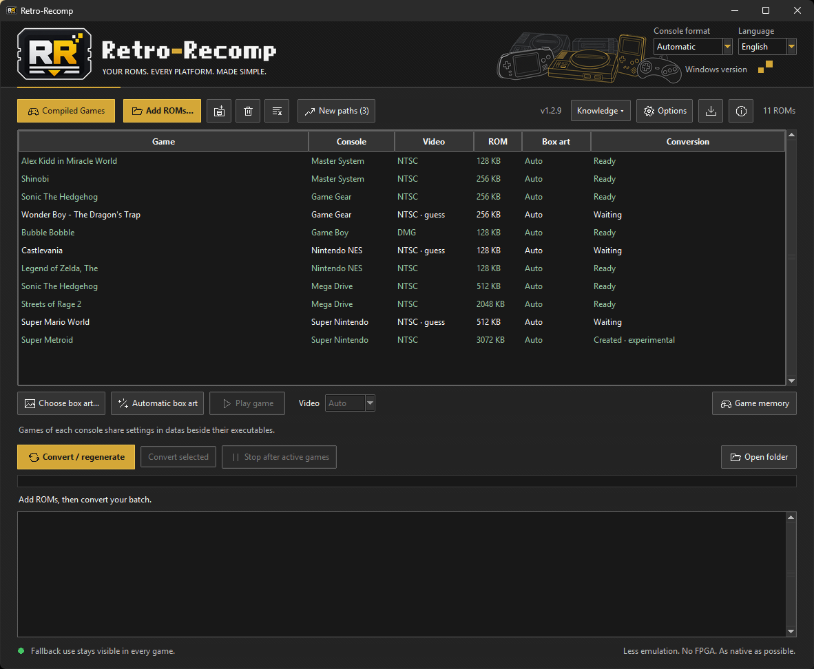
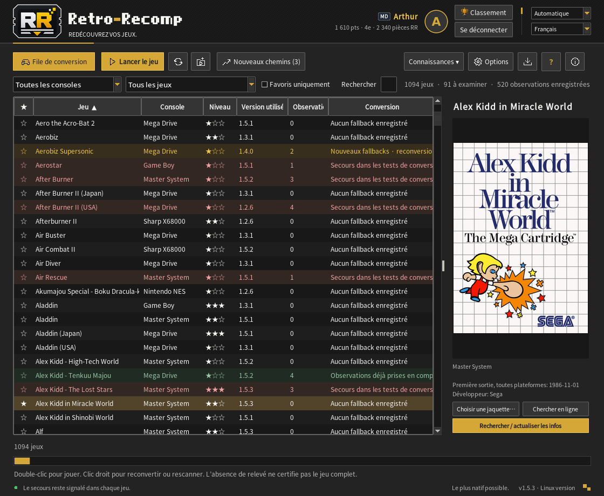
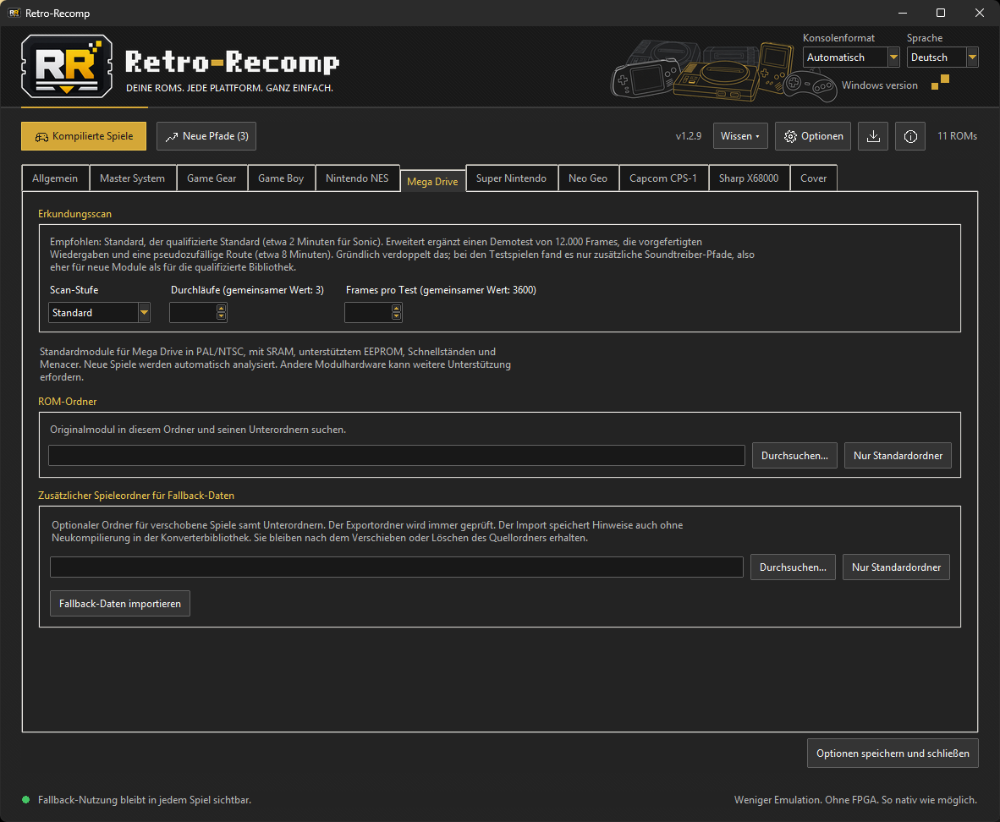
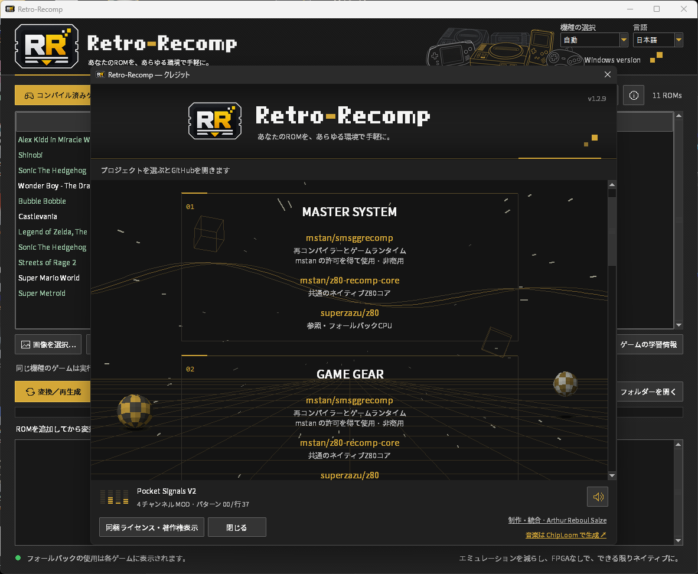
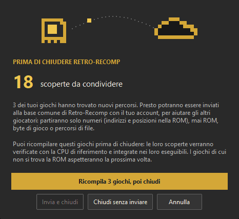
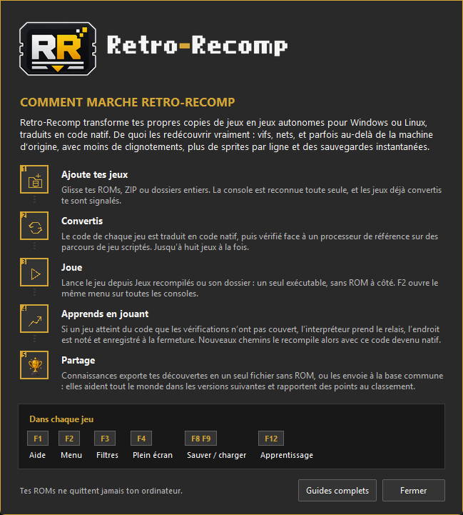
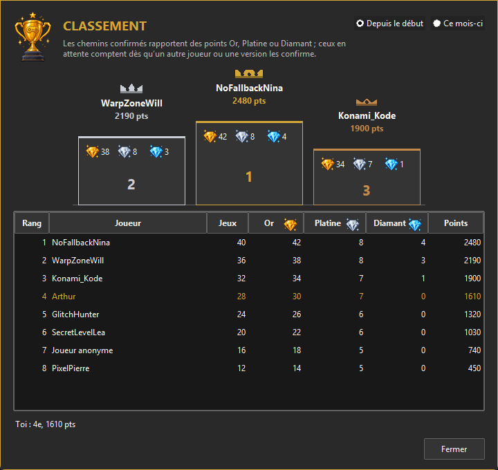

  

<h1 align="center">RetroRecomp</h1>

<strong>Retro consoles and classic computers. One growing project.</strong>

Master System · Game Gear · Game Boy · NES · Mega Drive · Super Nintendo · Neo Geo · Capcom CPS-1 · Sharp X68000

<em>Less emulation. No FPGA. As native as possible.</em>

  
  
  
  

  <a href="https://github.com/ArthurReboulSalze/RetroRecomp/releases">Download</a> ·
  <a href="docs/BUILDING.md">Build from source</a> ·
  <a href="docs/COMPATIBILITY.md">Compatibility</a> ·
  <a href="docs/RELEASE_NOTES.md">What's new</a> ·
  <a href="THIRD_PARTY_NOTICES.md">Credits and licensing</a> ·
  <a href="https://retro-recomp.com">Website</a>

  

<em>The conversion queue: drop games from several consoles and convert them together. Captured on Linux with a sample account; Windows shows the same window.</em>

RetroRecomp brings several recompilers together in one application. It turns
your own game dumps into standalone Windows or Linux executables, with as much
native code as possible: no emulator to configure, no dedicated FPGA hardware.

## What RetroRecomp does

**Convert**

- **Nine console profiles.** Master System, Game Gear, Game Boy, NES, Mega
  Drive, Super Nintendo and Neo Geo are supported; Capcom CPS-1 and Sharp
  X68000 are experimental. See [console support](#console-support).
- **A whole collection at once.** Drop ROMs, ZIPs, arcade romsets, disk images
  or mixed folders. Consoles are detected automatically, and up to eight
  conversions run side by side.
- **Checked native code.** Each conversion translates the game to native code
  and compares it with a reference CPU on scripted routes. Any remaining
  interpreter fallback is reported, never hidden.
- **Your choice of depth.** Quick, Standard, Extended or Thorough discovery per
  console, with reproducible pseudo-random play routes.
- **Standalone games.** Exports need no Python, no separate ROM file and no
  external SDL library, and can carry box-art icons.

**Keep your games current**

- **Only what needs it.** Up-to-date games are skipped. When an update only
  changes menus or presentation, games are
  [upgraded without rediscovery](docs/UPGRADES.md).
- **A collection that keeps itself current.** Compiled Games remembers your
  games, favorites, covers and short summaries. Discoveries saved when a game
  closes appear at once, without rescanning. Browse it with a controller too.
- **New paths (N).** One button recompiles only the games whose play found new
  paths; closing RetroRecomp offers the same.
- **Pick up where you left off.** An interrupted batch returns to the list.

**Learn and share**

- **Play to improve.** A game that meets interpreter fallback saves small hints
  when it closes; the next conversion uses them.
- **Shared knowledge.** Verified hints for **1,305 exact game identities** ship
  with the converter, the whole convertible Neo Geo library among them; your
  own discoveries stay in your local library.
- **Knowledge files.** Export your discoveries, qualified hints and raw
  observations alike, as one ROM-free file, or import someone else's. Only
  numbers travel: addresses and positions in the ROM, never ROM bytes. Imported
  hints are always rechecked, and set aside if they make a conversion fail.
- **The shared base and its leaderboard.** Sign in at
  [retro-recomp.com](https://retro-recomp.com) with an e-mailed code. Before
  each batch, the converter fetches the paths other players found for your
  exact ROMs (checked again by every conversion; when they come from a scan at
  least as long as yours, a quick check replaces discovery), and after it,
  sends your new discoveries in the background. Both are options. A new path
  earns points at once for its first finder; confirmed paths rise to Platinum
  or Diamond and bring RR coins, which buy a title shown under your pseudonym.
  Your portrait, points, coins and title sit in the converter's header. Every
  upload is rechecked before it can help a future version.

**Play**

- **One menu on every console.** F2 gathers controls and options on pages:
  keyboard, gamepad, guns, quit and restart combinations, audio filter. F1
  shows help, F3 changes filters (xBR, Scale2x, scanlines), F4 cycles
  fullscreen modes, F8/F9 save and load quick states.
- **Languages.** Games speak English, French, Italian, Spanish and German (F7);
  the converter also speaks Japanese, Chinese and Russian.
- **Light guns with the mouse.** Light Phaser, Zapper, Menacer and Super Scope.
- **Beyond the original limits, as options.** Fewer flickering sprites on
  Master System and Game Gear, no eight-sprite limit on NES, an enhanced Neo
  Geo mode and MVS/AES switching.

## Gallery

<table>
  <tr>
    <td width="50%"></td>
    <td width="50%"></td>
  </tr>
  <tr>
    <td align="center"><em>Compiled Games, in French: favorites, scan-level stars, covers, summaries and New paths.</em></td>
    <td align="center"><em>Options, in German: one tab per console, scan levels and folders.</em></td>
  </tr>
  <tr>
    <td width="50%"></td>
    <td width="50%" align="center"></td>
  </tr>
  <tr>
    <td align="center"><em>Credits, in Japanese: what Retro-Recomp brings, over a demoscene backdrop with live ChipLoom music.</em></td>
    <td align="center"><em>Before closing, in Italian: recompile the games with new paths.</em></td>
  </tr>
  <tr>
    <td width="50%" align="center"></td>
    <td width="50%" align="center"></td>
  </tr>
  <tr>
    <td align="center"><em>Help, in French: how it works in five steps.</em></td>
    <td align="center"><em>The leaderboard, in French (sample players): podium, crowns, class gems and shop badges.</em></td>
  </tr>
</table>

  

<em>Generated Master System games, with optional box-art icons. More on the <a href="https://retro-recomp.com">website</a>.</em>

## Play. Learn. Recompile.

The goal is native execution from the **first export**. Learning is an extra
safeguard for code paths the conversion checks have not reached: if a game
meets interpreter fallback, it keeps small hints in memory and saves them
**when you close it**, never during play. Regenerating then covers those paths.

  

Recording is on by default; **F12** switches it off or on, and each game's file
stays under about 128 KiB. **Options → console → Import fallback hints**
recovers hints from games stored elsewhere. See
[how the learning loop works](docs/RUNTIME_FEEDBACK.md) and
[sharing discoveries](docs/COMPILATION_LIBRARY.md#sharing-discoveries-between-converters).

## Console support

| Console | Current status |
| --- | --- |
| Master System | Supported; two players, PAL/NTSC, quick states and Light Phaser |
| Game Gear | Supported; native handheld display and colors |
| Game Boy | Supported; original Game Boy, quick states, grayscale or classic green |
| NES | Supported; validated cartridge layouts, PAL/NTSC, quick states and Zapper |
| Mega Drive | Supported; standard cartridges, PAL/NTSC, SRAM/supported EEPROM, quick states and Menacer |
| Super Nintendo | Supported standard cartridges; LoROM/HiROM, PAL/NTSC, quick states, battery saves and Super Scope |
| Neo Geo | Supported cartridge profile; arcade MVS, optional console AES, two players, scores, memory card and quick states |
| Capcom CPS-1 | Experimental; MAME/FBNeo ZIP romsets of the standard boards (no QSound), up to four players and six buttons, DIP switches, vertical games rotated, quick states |
| Sharp X68000 | Experimental; DIM/XDF disks and multi-disk sets, your own IPL and font ROM, quick states, mouse and keyboard |

Compatibility depends on the game and revision; see the
[compatibility guide](docs/COMPATIBILITY.md) and
[16-bit support](docs/CONSOLES_16BIT.md). The 16-bit profiles analyze new games
automatically; there is no fixed game list. Neo Geo needs your BIOS ZIP in
**Options → Neo Geo** ([guide](docs/NEOGEO.md)); CPS-1 needs no BIOS, and a
split clone needs its parent ZIP beside it ([guide](docs/CPS1.md)); the X68000
needs your own IPL and font ROM ([status](docs/X68000.md)).

## Get started

1. Download the **Windows setup EXE**, the **`.deb` package** (Debian, Ubuntu: double-click it) or the **Linux x86-64 `.run` installer** from the [latest release](https://github.com/ArthurReboulSalze/RetroRecomp/releases). Portable downloads remain available.
2. Add your ROMs or folders, leave console detection on **Automatic**, and convert.
3. Open the generated games in their console folders under **Games** beside the app.

Converting compiles each game on your computer: before the first conversion,
RetroRecomp offers to install the missing build tools itself (a portable Git and
a portable compiler on Windows, without administrator rights; a few packages on
Debian/Ubuntu); see the
[setup guide](docs/BUILDING.md). Playing the exported games needs no
development tools. ROMs and downloaded box art are not included.

Installers keep the in-app updater working without administrator rights;
games, settings, favorites and learning data survive updates and uninstall
([installation guide](docs/INSTALLING.md)). Update checks are manual. The
Linux package is built and checked on **Debian 13 / glibc 2.41**; other
distributions and ARM64 remain to be qualified ([Linux guide](docs/LINUX.md)).
All in-game shortcuts are listed in [controls](docs/CONTROLS.md).

## What comes next

The groundwork for these machines has been reviewed; each would join in its
own experimental phase: Capcom CPS-2, PC Engine / TurboGrafx-16, Game Boy
Advance, Atari ST, Amiga 500 and 1200 (WHDLoad-based), Nintendo 64 and
PlayStation. These are plans, not release dates or compatibility promises;
see the [roadmap](docs/ROADMAP.md).

## Measures, compatibility and credits

Interpreter fallback is reported when needed. Native coverage, CPU agreement,
hardware fidelity, gameplay testing and physical latency are separate measures;
native execution alone does not guarantee complete compatibility or zero
latency. Detailed checks live in the [documentation](docs/COMPATIBILITY.md),
performance work in the [performance notes](docs/RUNTIME_PERFORMANCE.md), and
each version's changes in the [release notes](docs/RELEASE_NOTES.md).

Created and integrated by [Arthur Reboul Salze](https://github.com/ArthurReboulSalze).
The app's **Credits** page links the independent projects behind each console.

Original RetroRecomp contributions use the [MIT license](LICENSE). Imported
components retain their own terms, including noncommercial restrictions;
MIT does not override them. See [third-party notices](THIRD_PARTY_NOTICES.md).
Notices are embedded in the converter; the matching
[UPX source archive](licenses/upx-5.2.1-src.tar.xz) is available in this repository.

Feedback and contributions are welcome. Please read [CONTRIBUTING.md](CONTRIBUTING.md).
