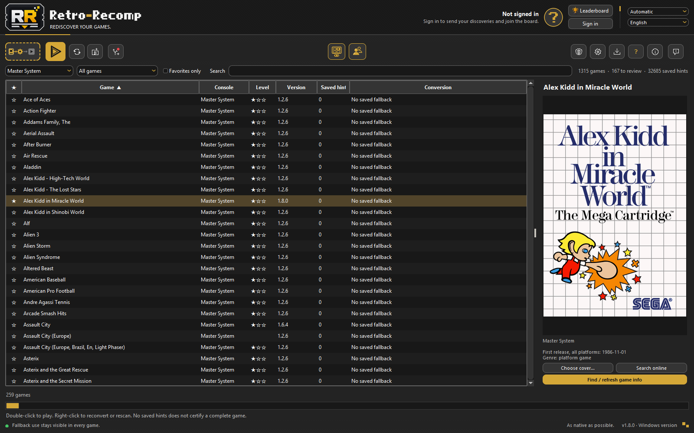
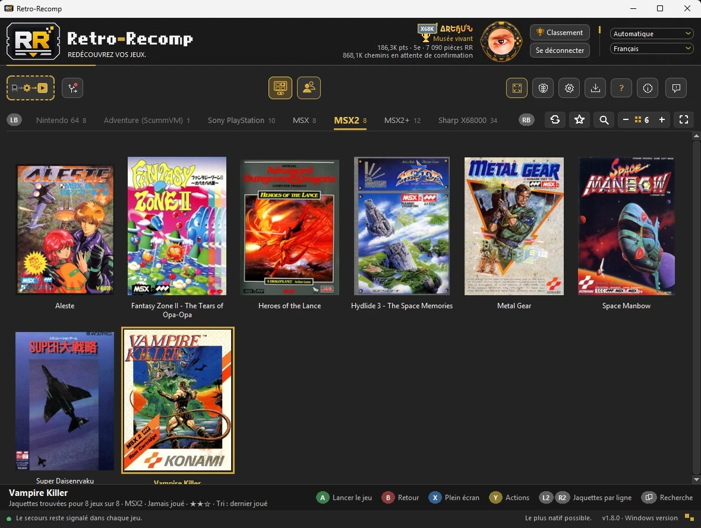
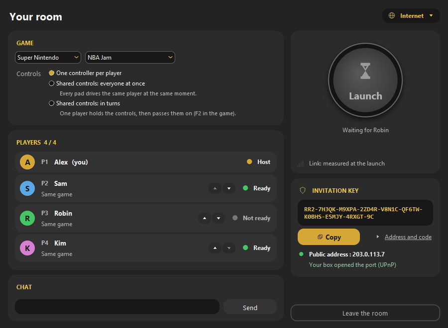
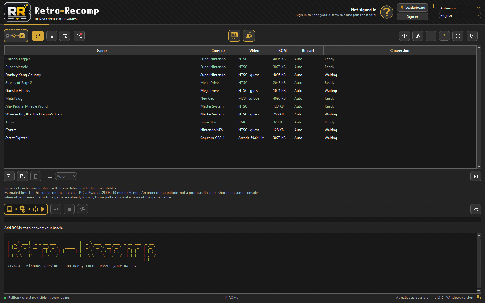

<h1 align="center">
   
  RetroRecomp
</h1>

<strong>Static recompiler for 20 retro consoles and computers. Native Windows &amp; Linux games, a gamepad front-end, and rollback multiplayer for up to 4 players.</strong>

Atari ST · Capcom CPS-1 · Capcom CPS-2 · Commodore Amiga · Commodore Amiga 1200 · Game Boy · Game Boy Advance · Game Gear · Master System · Mega Drive · MSX · MSX2 · MSX2+ · Neo Geo · NES · Nintendo 64 · PC Engine / TurboGrafx-16 · Sharp X68000 · Sony PlayStation · Super Nintendo · and Adventure (ScummVM)

<em>Less emulation. No FPGA. As native as possible.</em>

  
  
  
  
  
  

  <a href="https://github.com/ArthurReboulSalze/RetroRecomp/releases">Download</a> ·
  <a href="docs/BUILDING.md">Build from source</a> ·
  <a href="docs/COMPATIBILITY.md">Compatibility</a> ·
  <a href="docs/RELEASE_NOTES.md">What's new</a> ·
  <a href="THIRD_PARTY_NOTICES.md">Credits and licensing</a> ·
  <a href="https://retro-recomp.com">Website</a>

Powered by <a href="https://github.com/mstan">mstan</a> &amp; <a href="https://github.com/RetroPortingToolKit">RetroPortingToolKit</a>

https://github.com/user-attachments/assets/ac82a7b7-56d3-4ba2-a49c-c0a8ca068e2e

<em>RetroRecomp in under two minutes: how your own game dumps become native Windows and Linux programs.</em>

https://github.com/user-attachments/assets/ac2dff32-b23c-44a4-ab81-ef962833251d

<em>Under the hood, in under three minutes: how RetroRecomp is built and how it works.</em>

  

<em>Compiled Games: your converted games, their scan level and fallback status, and the chosen game's cover and card.</em>

  

<em>The front-end: a wall of covers per machine, played with a gamepad or the mouse, full screen or in the window.</em>

RetroRecomp brings several recompilers together in one application. It turns
your own game dumps into standalone Windows or Linux executables, with as much
native code as possible: no emulator to configure, no dedicated FPGA hardware.

## Play together (new in 1.9.0)

Every converted game can now be played with friends, each on their own PC. One player hosts a room from the **Multiplayer**
window, the others join with the invitation, and only the controllers travel between the PCs.

- **Local or Internet:** a room on your local network, or over the Internet with a key you send to your friends.
- **Up to four players** on the machines that had four (NES Four Score, Mega Drive Team Player, Super Nintendo and PC Engine
  multitaps, CPS boards, Nintendo 64), two on the others.
- **Rollback:** most machines do not wait for a far player's buttons; they guess them and correct themselves when they arrive.
  The PlayStation, the Nintendo 64 and the Game Boy Advance wait a frame or two instead.
- **Link cable:** two players can link their own Game Boy, Game Gear or Game Boy Advance consoles, as with a real cable.

Every PC checks that its game stays identical to the host's. Physical latency is not measured. How to host and join:
[docs/MULTIPLAYER.md](docs/MULTIPLAYER.md).

  

## Install in 3 steps

1. **Download.** Open the
   [latest release](https://github.com/ArthurReboulSalze/RetroRecomp/releases/latest) and take
   the file for your computer: `Retro-Recomp-<version>-windows-x64-setup.exe` on Windows,
   `retro-recomp_<version>_amd64.deb` on Debian or Ubuntu (double-click it), or
   `Retro-Recomp-<version>-linux-x86_64-install.run` on another 64-bit Linux. Windows may say
   *unknown publisher* because the installer is not signed with a paid certificate: choose
   **More info → Run anyway** (it is not a virus alert, see
   [Windows security warnings](docs/INSTALLING.md#windows-security-warnings)).
2. **Add your ROMs.** Start Retro-Recomp, drop your own ROM files, ZIPs, arcade romsets, disk
   images or whole folders on the window, and leave the console on **Automatic**. ROMs and box
   art are never included.
3. **Convert and play.** Press Convert. The first time, Retro-Recomp offers to install the build
   tools it needs; accept. Your games appear in one folder per console under **Games**, beside
   the application, and in the **Compiled Games** window.

  

<em>The converter: drop your games, press Convert. Front-end and Multiplayer are in the middle of the toolbar.</em>

The full guide, with portable downloads, updates and uninstalling, is
[docs/INSTALLING.md](docs/INSTALLING.md); the keys of every game are in
[docs/CONTROLS.md](docs/CONTROLS.md).

## Console support

<!-- qualification-gauges:begin (written by tools/qualification_gauges.py from docs/QUALIFICATION.md: edit the matrix there, not this block) -->

| Console | Status | Qualification | Multiplayer | CPU per frame |
| --- | --- | --- | --- | --- |
| [Atari ST](docs/ATARI_ST.md)\* | supported | `█████` 91 % | supported · rollback | [Win 1.03 ms (−9 %)](docs/PERFORMANCE.md#the-figures) |
| [Capcom CPS-1](docs/CPS1.md) | supported | `█████` 90 % | supported · rollback | [Win 1.05 ms (−1 %)](docs/PERFORMANCE.md#the-figures) |
| [Capcom CPS-2](docs/CPS2.md) | supported | `█████` 94 % | supported · rollback | [Win 1.19 ms (+4 %)](docs/PERFORMANCE.md#the-figures) |
| [Commodore Amiga](docs/AMIGA.md)\* | supported | `█████` 91 % | supported · rollback | [Win 1.12 ms (±0 %) · Linux 1.15 ms](docs/PERFORMANCE.md#the-figures) |
| [Commodore Amiga 1200](docs/AMIGA.md)\* | supported | `████░` 84 % | supported · rollback | [Win 2.11 ms (−1 %)](docs/PERFORMANCE.md#the-figures) |
| [Game Boy](docs/GAME_BOY.md) | supported | `█████` 97 % | supported · rollback · link cable | [Win 0.26 ms (±0 %)](docs/PERFORMANCE.md#the-figures) |
| [Game Boy Advance](docs/GAME_BOY_ADVANCE.md) | supported | `█████` 91 % | supported · delay · link cable | [Win 1.42 ms (±0 %)](docs/PERFORMANCE.md#the-figures) |
| [Game Gear](docs/GAME_GEAR.md) | supported | `█████` 93 % | supported · rollback · link cable | [Win 0.50 ms (+1 %)](docs/PERFORMANCE.md#the-figures) |
| [Master System](docs/MASTER_SYSTEM.md) | supported | `█████` 97 % | supported · rollback | [Win 0.44 ms (+2 %) · Linux 0.38 ms](docs/PERFORMANCE.md#the-figures) |
| [Mega Drive](docs/MEGADRIVE.md) | supported | `█████` 97 % | supported · rollback | [Win 1.74 ms (+1 %) · Linux 1.65 ms](docs/PERFORMANCE.md#the-figures) |
| [MSX](docs/MSX.md) | supported | `█████` 93 % | supported · rollback | [Win 0.40 ms (−1 %)](docs/PERFORMANCE.md#the-figures) |
| [MSX2](docs/MSX.md) | supported | `█████` 90 % | supported · rollback | [Win 0.68 ms (−2 %)](docs/PERFORMANCE.md#the-figures) |
| [MSX2+](docs/MSX.md) | supported | `█████` 91 % | supported · rollback | [Win 0.96 ms (−1 %)](docs/PERFORMANCE.md#the-figures) |
| [Neo Geo](docs/NEOGEO.md) | supported | `█████` 94 % | supported · rollback | [Win 3.20 ms (+4 %)](docs/PERFORMANCE.md#the-figures) |
| [Nintendo 64](docs/NINTENDO_64.md)\* | supported | `█████` 90 % | supported · delay | [Win 4.69 ms (±0 %)](docs/PERFORMANCE.md#the-figures) |
| [Nintendo NES](docs/NES.md) | supported | `█████` 91 % | supported · rollback | [Win 2.51 ms (−2 %)](docs/PERFORMANCE.md#the-figures) |
| [PC Engine / TurboGrafx-16](docs/PC_ENGINE.md) | supported | `█████` 94 % | supported · rollback | [Win 5.22 ms (±0 %)](docs/PERFORMANCE.md#the-figures) |
| [Sharp X68000](docs/X68000.md) | supported | `█████` 91 % | supported · rollback | [Win 1.07 ms (+1 %)](docs/PERFORMANCE.md#the-figures) |
| [Sony PlayStation](docs/PLAYSTATION.md)\* | supported | `████░` 81 % | supported · delay | [Win 3.83 ms (+4 %)](docs/PERFORMANCE.md#the-figures) |
| [Super Nintendo](docs/SNES.md) | supported | `█████` 94 % | supported · rollback | [Win 4.21 ms (−1 %) · Linux 4.56 ms](docs/PERFORMANCE.md#the-figures) |
| [Amstrad CPC](docs/AMSTRAD_CPC.md) | experimental (developer-only) | `░░░░░` 0 % | not offered | not measured |
| [ZX Spectrum](docs/ZX_SPECTRUM.md) | experimental (developer-only) | `░░░░░` 3 % | not offered | not measured |
| **[Adventure (ScummVM)](docs/SCUMMVM.md)** | supported | outside this list: emulated, 0 % native code | not offered | not measured |

\* The PlayStation, the Nintendo 64, the Atari ST and the two Amigas are not fully recompiled systems: each game runs on a complete emulator core inside its executable, with native code for the main CPU only, so their native share is not comparable with the other machines' ([how to read it](docs/ARCHITECTURE.md#machines-that-run-on-an-emulator-core); detail on each machine's page).

**Qualification**, approximate: the share of the gates that apply to a machine that are met (half a point for a
partial one), drawn from the matrix of [QUALIFICATION.md](docs/QUALIFICATION.md#progress-through-the-qualification-list). It is not a quality score, it mixes none of the five
measures, and it never decides a status: leaving the experimental status is the owner's own decision.

**CPU per frame**: the host's computing time for one frame of a game in solo on the reference PC ([PERFORMANCE.md](docs/PERFORMANCE.md#the-figures)), not latency. « Win » is Windows 11, « Linux » is WSL2 on the same PC. In parentheses, the change from the previous version measured (1.9.0 against 1.8.0 here); a minus sign means faster. A 60 Hz frame lasts 16.7 ms, and other PCs differ.

<!-- qualification-gauges:end -->

**Adventure (ScummVM)** is a category of its own, supported since 1.7.1: point-and-click adventure games run in ScummVM, emulated
(0 % native code, by design), each packed with its own files into one executable with its saves in `datas/`
([how it works and what supported means here](docs/SCUMMVM.md)). It is not part of the qualification matrix of the recompiled consoles.

The Capcom CPS-1 line includes its 18 QSound boards (CPS-1.5). Some machines need files you supply yourself: the Neo Geo
and the Game Boy Advance (their BIOS), the Sharp X68000 (its IPL and font ROM), and the QSound boards and the Capcom CPS-2 (their DSP ROM, and for the
CPS-2 the key file of the romset). The Atari ST (a TOS), the PlayStation (a BIOS) and the MSX, MSX2 and MSX2+ cartridges (an MSX, MSX2 or MSX2+ BIOS) take your own as an option and have a free fallback; MSX2+ disks need your own MSX2+ BIOS and disk ROM. The Commodore Amiga takes your own Kickstart image, needed only by the installs that ask for one. What each machine converts, its options
and its limits are on its page.

### In development

Six machines are being studied, in this order: the **SG-1000**, the **Game Boy Color**, the **ColecoVision**, the
**Amstrad CPC**, the **ZX Spectrum** and the **PC Engine CD**. None is available yet: each starts as an experimental
profile once its study is approved, and no date is promised. The ZX Spectrum's study is approved: its experimental profile
identifies snapshots and converts nothing yet ([status](docs/ZX_SPECTRUM.md)).

Per-machine plans are in the [roadmap](docs/ROADMAP.md).

Compatibility depends on the game and the revision; there is no fixed game list. See the
[compatibility guide](docs/COMPATIBILITY.md). Interpreter fallback is always reported: native
code, CPU fidelity, hardware fidelity, gameplay validation and physical latency are separate
measures, and native execution alone guarantees neither complete compatibility nor zero latency.

**New in 1.9.1.** The automatic sending of discoveries works again after a Game Boy Advance conversion, the leaderboard's podium shows the frames and portrait animations its players equipped, and a Discord button joins the toolbar.

**New in 1.9.0.** Multiplayer on every machine, on the local network or over the Internet, up to four players, with rollback on most machines and the link cable on every handheld ([above](#play-together-new-in-190)). A new F2 menu, sound that no longer crackles on six machines, a faster player's path on several machines, and a new toolbar in the converter. Every export of 1.8.0 is converted again once. Details in the [release notes](docs/RELEASE_NOTES.md).

## Community

Questions, help and news: join the [RetroRecomp Discord server](https://discord.gg/VZeJYfNZgz). Bugs go to [GitHub issues](https://github.com/ArthurReboulSalze/RetroRecomp/issues) or the converter's **Report a problem** button ([CONTRIBUTING.md](CONTRIBUTING.md#reports-and-roms)).

## Learn more

How it works, what each machine does and how the project is run: start from the
[documentation index](docs/INDEX.md). The windows of the converter are in the
[screenshots](docs/SCREENSHOTS.md), each release's changes in the
[release notes](docs/RELEASE_NOTES.md), and the machines planned next in the
[roadmap](docs/ROADMAP.md).

## For developers

- [docs/BUILDING.md](docs/BUILDING.md): build and run from source, and the dependencies.
- [CONTRIBUTING.md](CONTRIBUTING.md): how to propose a change.
- [docs/AGENTS_GUIDE.md](docs/AGENTS_GUIDE.md): the repository map, the checks that need no ROM and the pitfalls, for coding agents and people alike.
- [docs/STANDARDS.md](docs/STANDARDS.md): the rules every change follows.

## Credits and licence

Created and integrated by [Arthur Reboul Salze](https://github.com/ArthurReboulSalze).
The app's **Credits** page links the independent projects behind each console.

Original RetroRecomp contributions use the [MIT license](LICENSE). Imported
components retain their own terms, including noncommercial restrictions;
MIT does not override them. See [third-party notices](THIRD_PARTY_NOTICES.md).
Notices are embedded in the converter; the matching
[UPX source archive](licenses/upx-5.3.0-src.tar.xz) is available in this repository.
