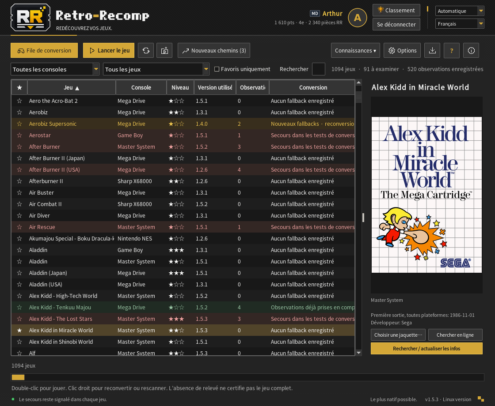

<h1 align="center">
   
  RetroRecomp
</h1>

<strong>Retro consoles and classic computers. One growing project.</strong>

Master System · Game Gear · Game Boy · NES · Mega Drive · Super Nintendo · Neo Geo · Capcom CPS-1 · Sharp X68000 · Capcom CPS-2 · PC Engine / TurboGrafx-16 · Game Boy Advance · Commodore Amiga · Atari ST · Nintendo 64 · Sony PlayStation (the last six experimental)

<em>Less emulation. No FPGA. As native as possible.</em>

  
  
  
  

  <a href="https://github.com/ArthurReboulSalze/RetroRecomp/releases">Download</a> ·
  <a href="docs/BUILDING.md">Build from source</a> ·
  <a href="docs/COMPATIBILITY.md">Compatibility</a> ·
  <a href="docs/RELEASE_NOTES.md">What's new</a> ·
  <a href="THIRD_PARTY_NOTICES.md">Credits and licensing</a> ·
  <a href="https://retro-recomp.com">Website</a>

Powered by <a href="https://github.com/mstan">mstan</a> &amp; <a href="https://github.com/RetroPortingToolKit">RetroPortingToolKit</a>

https://github.com/user-attachments/assets/818d3278-d698-491e-a58b-e11edc602923

<em>RetroRecomp in under two minutes: how your own game dumps become native Windows and Linux programs.</em>

https://github.com/user-attachments/assets/ac2dff32-b23c-44a4-ab81-ef962833251d

<em>Under the hood, in under three minutes: how RetroRecomp is built and how it works.</em>

  

<em>Compiled Games, in French: favorites, scan-level stars, covers, summaries and New paths.</em>

RetroRecomp brings several recompilers together in one application. It turns
your own game dumps into standalone Windows or Linux executables, with as much
native code as possible: no emulator to configure, no dedicated FPGA hardware.

## Install in 3 steps

1. **Download.** Open the
   [latest release](https://github.com/ArthurReboulSalze/RetroRecomp/releases/latest) and take
   the file for your computer: `Retro-Recomp-<version>-windows-x64-setup.exe` on Windows,
   `retro-recomp_<version>_amd64.deb` on Debian or Ubuntu (double-click it), or
   `Retro-Recomp-<version>-linux-x86_64-install.run` on another 64-bit Linux. Windows may say
   *unknown publisher* because the installer is not signed with a paid certificate: choose
   **More info → Run anyway** (it is not a virus alert, see
   [Windows security warnings](docs/INSTALLING.md#windows-security-warnings)).
2. **Add your ROMs.** Start Retro-Recomp, drop your own ROM files, ZIPs, arcade romsets, disk
   images or whole folders on the window, and leave the console on **Automatic**. ROMs and box
   art are never included.
3. **Convert and play.** Press Convert. The first time, Retro-Recomp offers to install the build
   tools it needs; accept. Your games appear in one folder per console under **Games**, beside
   the application, and in the **Compiled Games** window.

The full guide, with portable downloads, updates and uninstalling, is
[docs/INSTALLING.md](docs/INSTALLING.md); the keys of every game are in
[docs/CONTROLS.md](docs/CONTROLS.md).

## Console support

<!-- qualification-gauges:begin (written by tools/qualification_gauges.py from docs/QUALIFICATION.md: edit the matrix there, not this block) -->

| Console | Status | Qualification progress |
| --- | --- | --- |
| [Master System](docs/MASTER_SYSTEM.md) | supported | `██████████` 97 % |
| [Game Gear](docs/GAME_GEAR.md) | supported | `█████████░` 93 % |
| [Game Boy](docs/GAME_BOY.md) | supported | `██████████` 97 % |
| [Nintendo NES](docs/NES.md) | supported | `█████████░` 91 % |
| [Mega Drive](docs/MEGADRIVE.md) | supported | `████████░░` 84 % |
| [Super Nintendo](docs/SNES.md) | supported | `█████████░` 94 % |
| [Neo Geo](docs/NEOGEO.md) | supported | `█████████░` 94 % |
| [Capcom CPS-1](docs/CPS1.md) | supported | `█████████░` 90 % |
| [Sharp X68000](docs/X68000.md) | supported | `█████████░` 91 % |
| [Capcom CPS-2](docs/CPS2.md) | supported | `█████████░` 94 % |
| [PC Engine / TurboGrafx-16](docs/PC_ENGINE.md) | experimental | `█████████░` 89 % |
| [Game Boy Advance](docs/GAME_BOY_ADVANCE.md) | experimental | `████░░░░░░` 43 % |
| [Commodore Amiga](docs/AMIGA.md) | experimental | `█████░░░░░` 47 % |
| [Atari ST](docs/ATARI_ST.md) | experimental | `█████░░░░░` 53 % |
| [Nintendo 64](docs/NINTENDO_64.md) | experimental | `███░░░░░░░` 34 % |
| [Sony PlayStation](docs/PLAYSTATION.md) | experimental | `████░░░░░░` 40 % |

**Qualification progress**, approximate: the share of the gates that apply to a machine that are met (half a point for a
partial one), drawn from the matrix of [QUALIFICATION.md](docs/QUALIFICATION.md#progress-through-the-qualification-list). It is not a quality score, it mixes none of the five
measures, and it never decides a status: leaving the experimental status is the owner's own decision.

<!-- qualification-gauges:end -->

The PlayStation, the Nintendo 64, the Atari ST and the Amiga are not fully recompiled systems: each game runs on a complete emulator core inside its executable, with native code for the main CPU only, so their native share is not comparable with the other machines' ([how to read it](docs/ARCHITECTURE.md#machines-that-run-on-an-emulator-core); detail on each machine's page).

**Adventure (ScummVM)** is a category of its own, supported since 1.7.1: point-and-click adventure games run in ScummVM, emulated
(0 % native code, by design), each packed with its own files into one executable with its saves in `datas/`
([how it works and what supported means here](docs/SCUMMVM.md)). It is not part of the qualification matrix of the recompiled consoles.

The Capcom CPS-1 line includes its 18 QSound boards (CPS-1.5). Some machines need files you supply yourself: the Neo Geo
and the Game Boy Advance (their BIOS), the Sharp X68000 (its IPL and font ROM), and the QSound boards and the Capcom CPS-2 (their DSP ROM, and for the
CPS-2 the key file of the romset). The Atari ST (a TOS) and the PlayStation (a BIOS) take your own as an option and have a free fallback. The Commodore Amiga takes your own Kickstart image, needed only by the installs that ask for one. What each machine converts, its options
and its limits are on its page.

### In development

No other machine is available yet. Each new one starts as an experimental profile; no date is promised.

Planned: the Amiga 1200. Per-machine plans are in the [roadmap](docs/ROADMAP.md).

Compatibility depends on the game and the revision; there is no fixed game list. See the
[compatibility guide](docs/COMPATIBILITY.md). Interpreter fallback is always reported: native
code, CPU fidelity, hardware fidelity, gameplay validation and physical latency are separate
measures, and native execution alone guarantees neither complete compatibility nor zero latency.

**New in 1.7.1.** The Atari ST, the Nintendo 64 and the PlayStation open as experimental machines; Adventure (ScummVM) is supported; the Amiga and the Game Boy Advance run more of their code natively. Every export of 1.7.0 is converted again once. Details in the [release notes](docs/RELEASE_NOTES.md).

## Learn more

How it works, what each machine does and how the project is run: start from the
[documentation index](docs/INDEX.md). The windows of the converter are in the
[screenshots](docs/SCREENSHOTS.md), each release's changes in the
[release notes](docs/RELEASE_NOTES.md), and the machines planned next in the
[roadmap](docs/ROADMAP.md).

## For developers

- [docs/BUILDING.md](docs/BUILDING.md): build and run from source, and the dependencies.
- [CONTRIBUTING.md](CONTRIBUTING.md): how to propose a change.
- [docs/AGENTS_GUIDE.md](docs/AGENTS_GUIDE.md): the repository map, the checks that need no ROM and the pitfalls, for coding agents and people alike.
- [docs/STANDARDS.md](docs/STANDARDS.md): the rules every change follows.

## Credits and licence

Created and integrated by [Arthur Reboul Salze](https://github.com/ArthurReboulSalze).
The app's **Credits** page links the independent projects behind each console.

Original RetroRecomp contributions use the [MIT license](LICENSE). Imported
components retain their own terms, including noncommercial restrictions;
MIT does not override them. See [third-party notices](THIRD_PARTY_NOTICES.md).
Notices are embedded in the converter; the matching
[UPX source archive](licenses/upx-5.3.0-src.tar.xz) is available in this repository.
