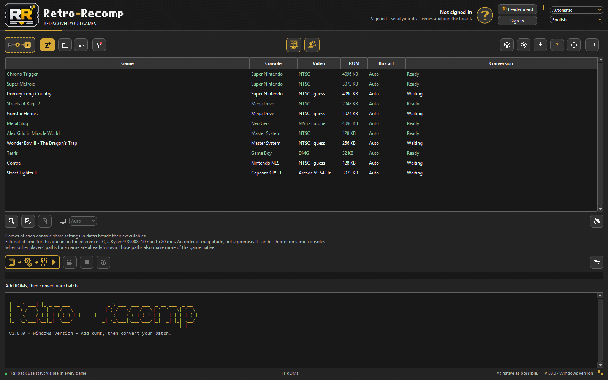
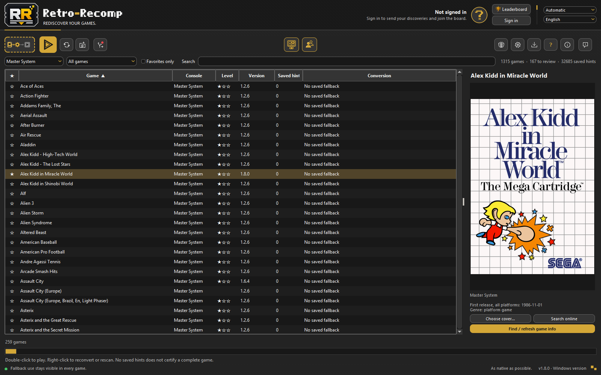
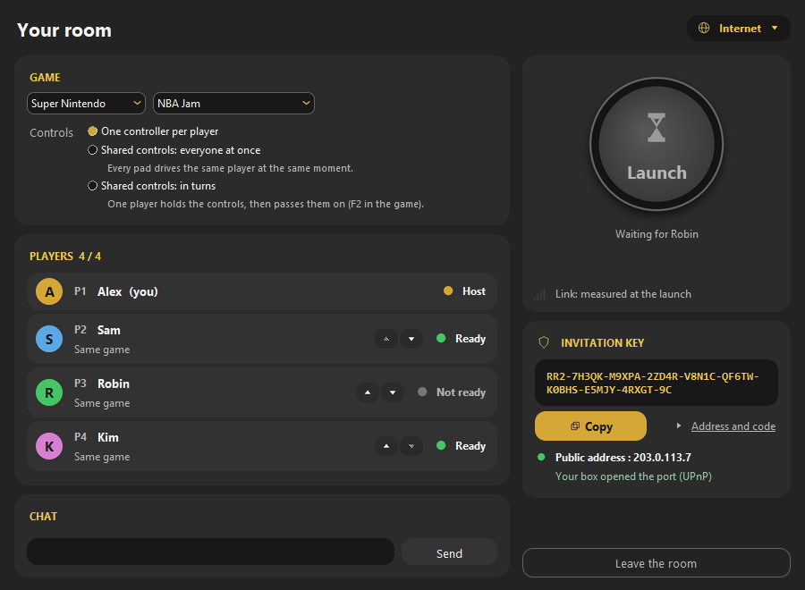
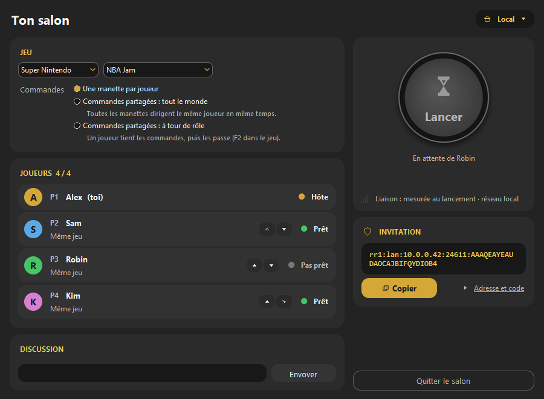
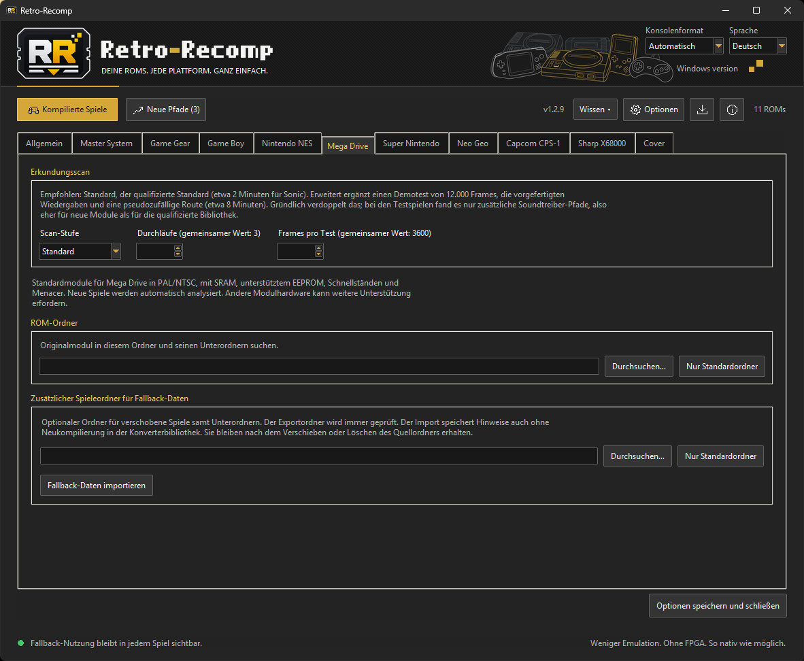
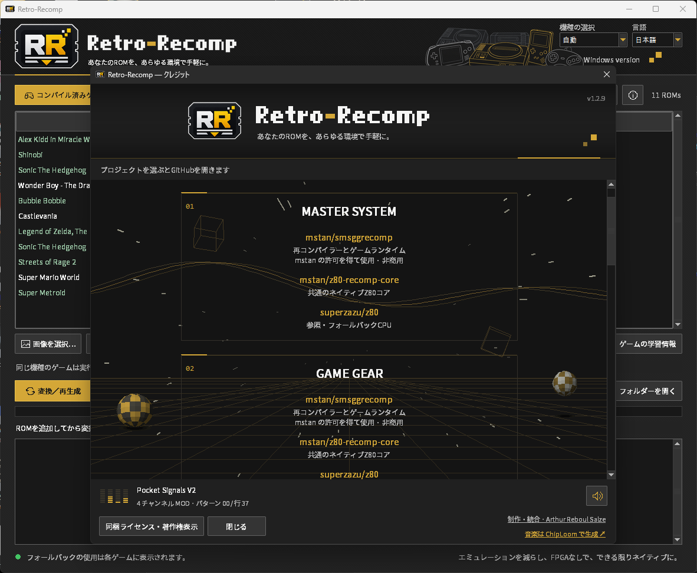
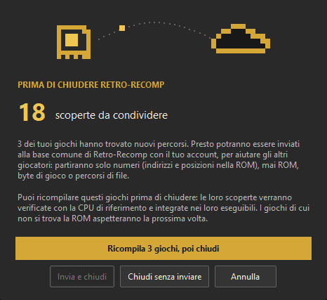
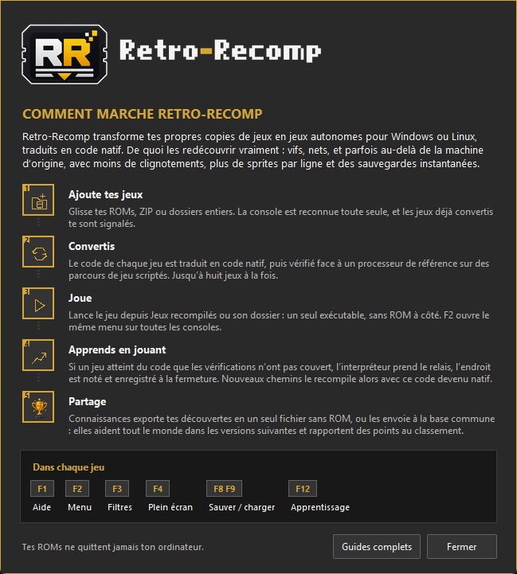
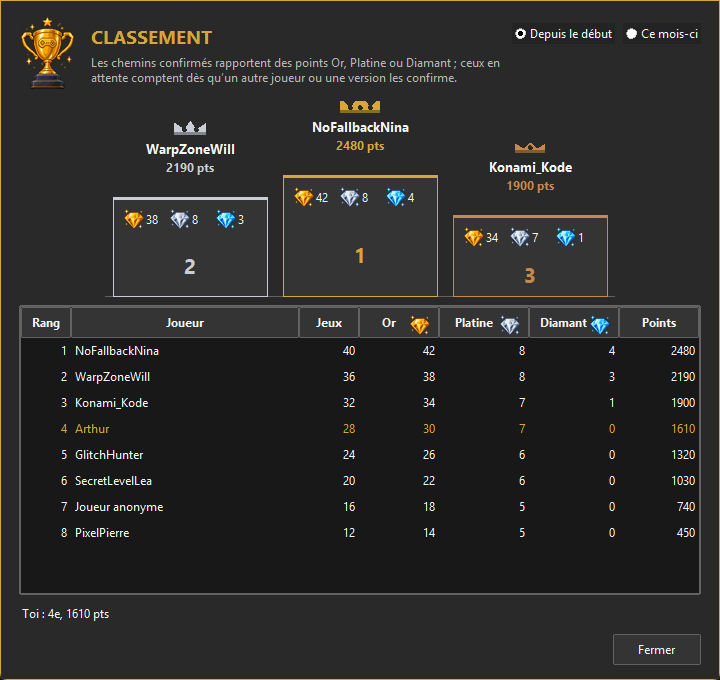
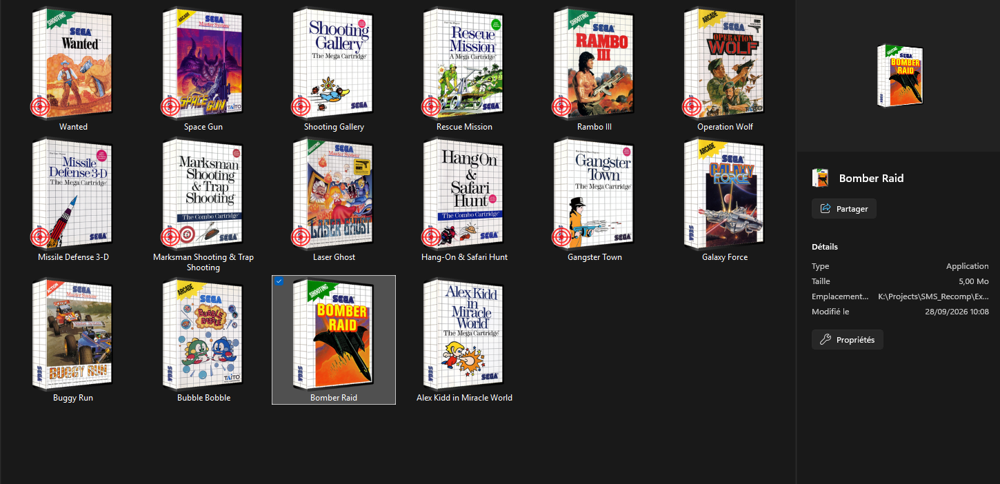

# Screenshots

A few windows of the converter, in several of its eight interface languages. The accounts and players shown
are samples. Covers appear here only as they appear in the app, small and inside its windows: no cover image file is in
the repository (Arthur, 20 November 2026). For what each window does, see
[INSTALLING.md](INSTALLING.md) (first start), [COMPILED_GAMES.md](COMPILED_GAMES.md) (the collection),
[BOXART.md](BOXART.md) (covers and icons), [CREDITS.md](CREDITS.md) (the credits window) and
[LANGUAGES.md](LANGUAGES.md); playing together is in [MULTIPLAYER.md](MULTIPLAYER.md). The converter's window is the
first picture of the [README](../README.md).

## The converter

The converter (1.9.0): drop games from several machines and press **Convert**. The toolbar keeps the queue's buttons on the
left, **Front-end** and **Multiplayer** in the middle, and Knowledge, Options, updates, help, credits and Report a problem on
the right.

## Compiled Games

Compiled Games, filtered to one console: each game's scan level, the version that built it, its saved hints and its fallback
status, and the chosen game's cover and card. The front-end, the wall of covers, is described in
[COMPILED_GAMES.md](COMPILED_GAMES.md).

## Multiplayer

An Internet room for four players ([MULTIPLAYER.md](MULTIPLAYER.md)): the seats and their checks, the controls mode, the chat,
and the invitation key with the public address the box opened (UPnP). The players are samples and the address is a
documentation address.

The same window in French, for a room on the local network.

## Options

Options, in German: one tab per console, scan levels and folders.

## Credits

Credits, in Japanese: what Retro-Recomp brings, over a demoscene backdrop with live ChipLoom music.

## Closing card

Before closing, in Italian: recompile the games with new paths.

## Help

Help, in French: how it works in five steps, the keys every game shares and a button to report a problem.

## Leaderboard

The leaderboard, in French (sample players): podium, crowns, class gems and shop badges.

## Master System games in Windows Explorer

Generated Master System games, with optional box-art icons. More on the [website](https://retro-recomp.com).
